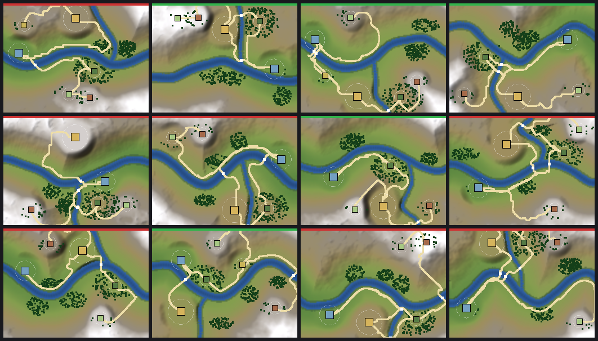

# Valley generation sketch

Experiment, reachable from the main menu as **Valley Generator (Experiment)**. A
rough, whole-pipeline pass at generating a valley (terrain, settlements, roads,
fords, vegetation) from a seed, validating it, and reviewing seeds visually. It
does not touch `river_valley.gd` or the authored valley; nothing here is wired
into the game view yet.



Green bar = passes validation, red = rejected. Regenerate with
`check_valley_generator.gd` (below).

## Pipeline (`scripts/valley/gen/`)

| Stage | Where | What it does |
|---|---|---|
| 1 Roster | `valley_gen_sites.gd` | Town, port, ore, woodland, pasture, optional farm hamlet; names shuffled by seed. |
| 2 Terrain | `valley_gen_terrain.gd` | Main river (and a tributary meeting it at a junction) over a sloping valley floor, plus noise hills and ridges; rivers carved into the ground. Same 320x240 footprint as the authored valley. |
| 3 Sites | `valley_gen_sites.gd` | Scores candidate spots per role (flatness, bank distance, elevation, downstream position), then grades a flat pad under each site. |
| 4 Roads | `valley_gen_roads.gd` | `AStarGrid2D` least-cost paths (slope and water weighted), minimum spanning tree plus a town-port trade road, then a ford record for every road/river crossing. |
| 5 Vegetation | `valley_generator.gd` | Per-settlement and free forest patches as `vegetation` records. |
| 6 Emit | `valley_generator.gd` | A `ValleyMapDefinition` (settlements, rivers, roads, crossings, junctions, vegetation) plus the heightfield. |
| 7 Validate | `valley_gen_validator.gd` | `validate_geometry()`, sites dry, pad slope, road grade and detour, and a supply *proxy* (every settlement's inputs have a producer within road range). |

`valley_generator.gd` runs it all as one deterministic function of the seed
(~1 s per valley in GDScript). `valley_gen_relief.gd` renders relief, vertex
tints and contact sheets; `valley_gen_view.gd` is the scene.

## What it shows so far

- The whole chain runs and the output is a normal `ValleyMapDefinition`, so the
  existing geometry validation applies unchanged.
- Roughly 40-50% of seeds pass the current checks (5/12 on seeds 1-12). The
  rejects are informative: no valid town site, roads climbing valley walls,
  isolated ore. Tuning the generator or the thresholds is the next knob.
- Settlements sit on graded pads, so a household town view could be placed on
  one with `(x, height(x, y), y)` as the town layout doc describes.

## Known gaps

- **Not the real economy.** The supply check is a proxy; running the household
  economy on a generated valley needs the valley-economy integration (#19).
- **Pad size vs town footprint.** Pads are 14-28 units; the town layout is
  +/-80. The embedded town view has its own ground, so terrain around a town in
  the valley is not yet built to that footprint.
- Roads are visual only (no `ValleySeed` edge lengths derived from them), the
  river is shaded blue rather than a water surface, and there is no coast,
  hand-edit layer, approved-seed registry, or valley gates for stitching valleys.
- Terrain constants (`valley_gen_terrain.gd`) are not yet archetype-driven; there
  is one archetype, `river_valley_port`.

## Checks

```powershell
# batch of seeds: determinism, per-seed report, contact sheet
& 'C:\Users\jrfor\OneDrive\Desktop\gamedev\Godot_v4.6.2-stable_win64_console.exe' --headless --path . --script scripts/valley/harness/check_valley_generator.gd -- docs/images/valley-gen-contact-sheet.png 1 12
# the scene loads, 3D/sheet modes and seed changes work
& '...console.exe' --headless --path . --script scripts/valley/harness/check_valley_generator_scene.gd
# screenshots (needs a renderer): <output>_map.png, _3d.png, _sheet.png
& '...console.exe' --path . --script res://scripts/valley/harness/capture_valley_generator.gd -- --output=C:/tmp/valley --seed=4
```
