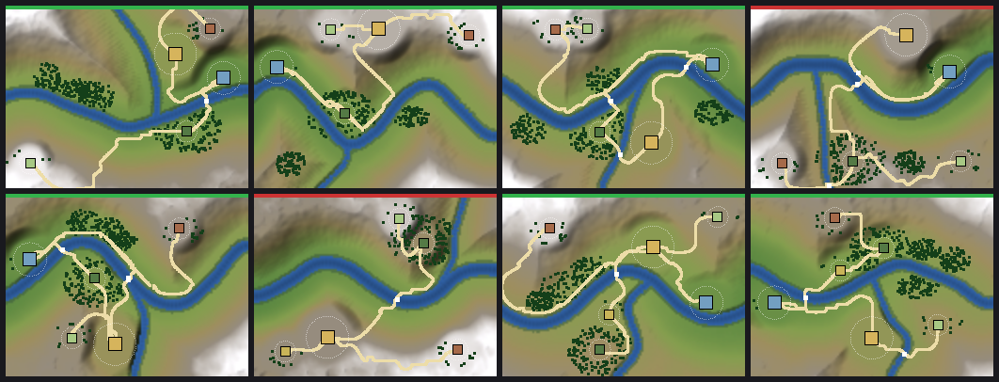
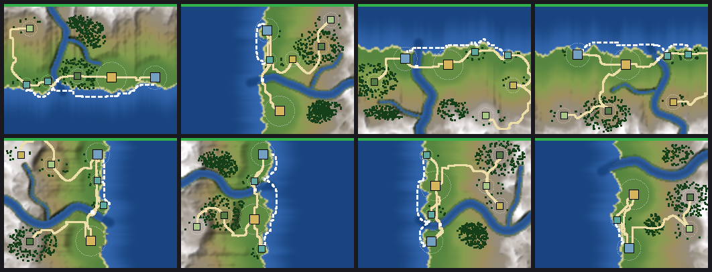
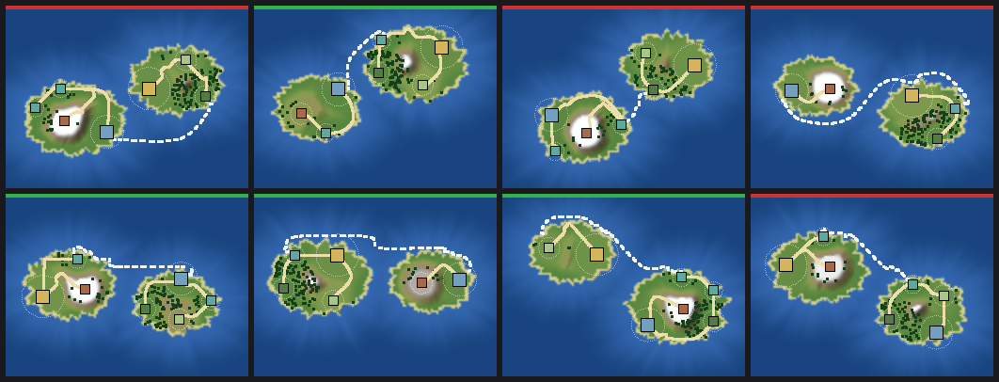

# Valley generation sketch

Experiment, reachable from the main menu as **Valley Generator (Experiment)**. A
rough, whole-pipeline pass at generating a landscape (terrain, water,
settlements, roads, fords, vegetation) from a **spec**, validating it, and
reviewing seeds visually. It does not touch `river_valley.gd` or the authored
valley; nothing here is wired into the game view yet.

Eight seeds per landscape (green bar = passes validation, red = rejected):

| River valley | Coast | Island |
|---|---|---|
|  |  |  |

## The input: `ValleySpec`

`scripts/valley/gen/valley_spec.gd`. The seed only supplies detail *inside* the
shape the spec describes. It is JSON-able, so a spec plus its seed is a
reviewable, approved record (the format for the ~50 reviewed places).

```json
{
  "landscape": "coast",
  "main_river": true,
  "tributaries": 1,
  "islands": 1,
  "sea_routes": true,
  "relief": 1.0,
  "sea_side": "",
  "seed": 3,
  "settlements": [
    {"role": "town", "count": 1, "optional": false},
    {"role": "fishing", "count": 2, "optional": true}
  ]
}
```

| Field | Meaning |
|---|---|
| `landscape` | `river_valley`, `coast`, or `island` (see below). |
| `main_river` / `tributaries` | Whether a main river exists, and 0-2 tributaries joining it at confluences. |
| `islands` | Island landscape only: 1-3 separate islands. |
| `sea_routes` | Boat routes between harbours (and between islands). Sea landscapes only. |
| `relief` | 0.3-2.0 multiplier on hill and valley-wall height. |
| `sea_side` | Coast only: `north`/`south`/`east`/`west`, or empty to let the seed choose. |
| `settlements` | Roster: `role`, `count`, and `optional` (skipped silently when no site fits; a missing required role is a validation failure). Roles: town, port, ore, woodland, pasture, farm, fishing. Max 10. |
| `seed` | Detail only: meanders, noise, site jitter, names. |

`ValleySpec.preset(landscape, seed)` gives each landscape's default roster;
`validate()` rejects unknown landscapes/roles, tributaries without a river, and
so on, and the generator refuses an invalid spec.

## Landscapes

- **River valley**: a main river across a sloping valley floor, tributaries,
  walls and ridges. Port sits downstream on the river.
- **Coast**: a wobbly coastline on one side, land rising inland, a river
  reaching the sea at a mouth. Port and fishing villages sit on the shore.
- **Island**: one to three stretched, irregularly outlined islands in open sea,
  each a smooth dome (smaller islands rise less), optionally a river on the
  largest. Settlements are spread across the islands, and boat routes link
  them (the preset is two islands).

New landscapes (highland, bog, ...) add a base-height function and a river
layout; sites, roads, validation and the viewer do not change.

## Keeping a seed you like

In the viewer: **Copy spec** puts the JSON on the clipboard, **Save spec**
writes `data/valley_specs/<landscape>_<seed>.json` (from the editor or a desktop
run; exported builds fall back to `user://valley_specs/`). The spec box is
editable: change the roster or any field, then **Apply**. To use one in code:

```gdscript
var parsed := ValleySpecScript.from_json(FileAccess.get_file_as_string(path))
if parsed["spec"] != null:
    var result := ValleyGeneratorScript.generate(parsed["spec"])  # terrain, sites, map, report
```

An example is checked in at `data/valley_specs/coast_3.json`. Generation is
deterministic for a given spec and code version, but it is *not* frozen: a
generator change can alter an old spec's output. Baking the approved result
(heightmap plus the emitted `ValleyMapDefinition`) is the follow-up for
anything the game depends on.

## Pipeline (`scripts/valley/gen/`)

| Stage | Where | What it does |
|---|---|---|
| 1 Roster | `valley_spec.gd`, `valley_gen_sites.gd` | The spec's settlement list, names shuffled by seed. |
| 2 Terrain | `valley_gen_terrain.gd` | Per-landscape base height, rivers carved in, coast/sea. Same 320x240 footprint as the authored valley. |
| 3 Sites | `valley_gen_sites.gd` | Scores candidate spots per role (flatness, water distance, elevation, downstream or shore position), then grades a flat pad under each site. |
| 4 Roads | `valley_gen_roads.gd` | `AStarGrid2D` least-cost paths (slope and water weighted, sea impassable), minimum spanning tree plus a town-port road, then a ford record for every road/river crossing. |
| 4b Sea routes | `valley_gen_sea.gd` | `AStarGrid2D` over open water (land solid, beaches discouraged) between harbours: on islands, a spanning link between the separate land road networks; on a coast, a chain along the shore. Emitted as `ValleyMapDefinition.water_routes`, ending at settlement waterfront anchors. |
| 5 Vegetation | `valley_generator.gd` | Per-settlement and free forest patches as `vegetation` records. |
| 6 Emit | `valley_generator.gd` | A `ValleyMapDefinition` plus the heightfield. |
| 7 Validate | `valley_gen_validator.gd` | Sea share, `validate_geometry()`, sites dry, pad slope, road grade and detour, sea routes stay on open water, connectivity (roads plus sea routes), and a supply *proxy*. |

`valley_generator.gd` runs it as one deterministic function of the spec
(0.1-1 s per landscape in GDScript). `valley_gen_relief.gd` renders relief,
vertex tints and contact sheets; `valley_gen_view.gd` is the scene.

## What it shows so far

- The whole chain runs for three landscapes and emits a normal
  `ValleyMapDefinition`, so existing geometry validation applies unchanged.
- On seeds 1-8: river valley 6/8 pass, coast 8/8, two-island archipelago 4/8, with every archipelago seed linked by a sea route. The rejects are
  informative (no valid port site, roads climbing walls).
- Settlements sit on graded pads, so a household town view could be placed on
  one with `(x, height(x, y), y)` as the town layout doc describes.

## Known gaps

- **Not the real economy.** The supply check is a proxy (a port counts as
  outside trade and supplies any import); running the household economy on a
  generated landscape needs the valley-economy integration (#19).
- **Pad size vs town footprint.** Pads are 12-28 units; the town layout is
  +/-80.
- Water routes are geographic only (no `ValleySeed` edge or travel time), the
  game view has no renderer for `water_routes` yet, and boats do not avoid
  river mouths or follow currents. Islands of different size are not
  balanced against the roster (a small island may hold only a fishing hamlet).
- Coast terrain shows faint streaks inland (height follows the wobbly shore
  distance). Roads are visual only (no `ValleySeed` edge lengths derived from
  them), rivers are shaded, not a water surface, and sea-bound rivers leave a
  dark channel in the shallows.
- No hand-edit layer, approved-seed registry, valley gates for stitching
  landscapes into a world map, or highland/bog landscapes yet.
- Thresholds in `valley_gen_validator.gd` are tuned by eye.

## Checks

```powershell
# batch of seeds: determinism, spec round-trip, per-seed report, contact sheet
& 'C:\Users\jrfor\OneDrive\Desktop\gamedev\Godot_v4.6.2-stable_win64_console.exe' --headless --path . --script scripts/valley/harness/check_valley_generator.gd -- docs/images/valley-gen-coast.png 1 8 coast
# the scene loads; modes, seed changes, and the spec box work
& '...console.exe' --headless --path . --script scripts/valley/harness/check_valley_generator_scene.gd
# screenshots (needs a renderer): <output>_map.png, _3d.png, _sheet.png
& '...console.exe' --path . --script res://scripts/valley/harness/capture_valley_generator.gd -- --output=C:/tmp/valley --seed=4 --landscape=coast
```
